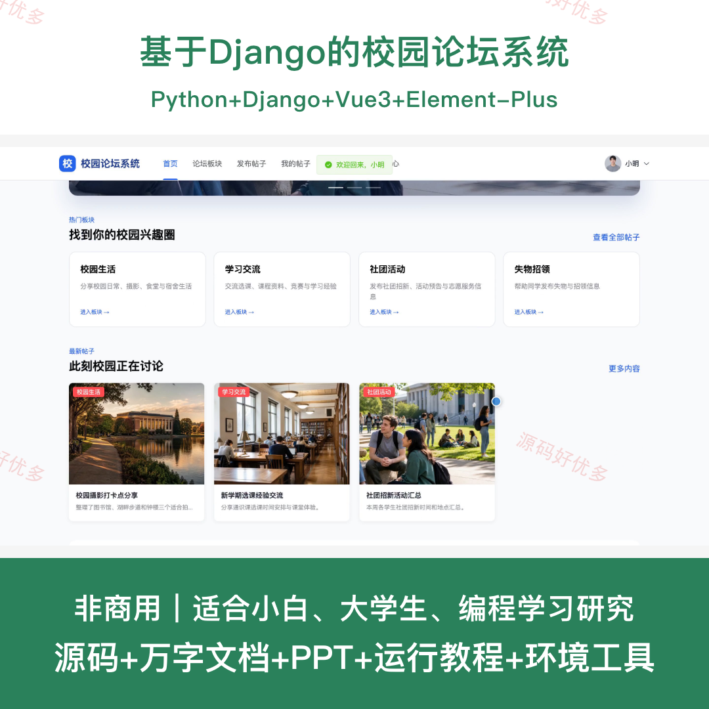
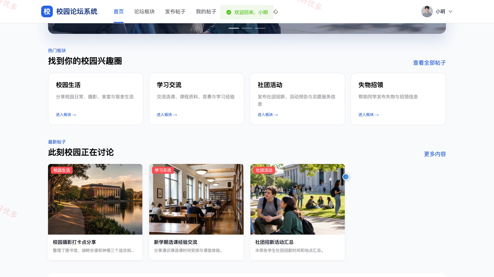
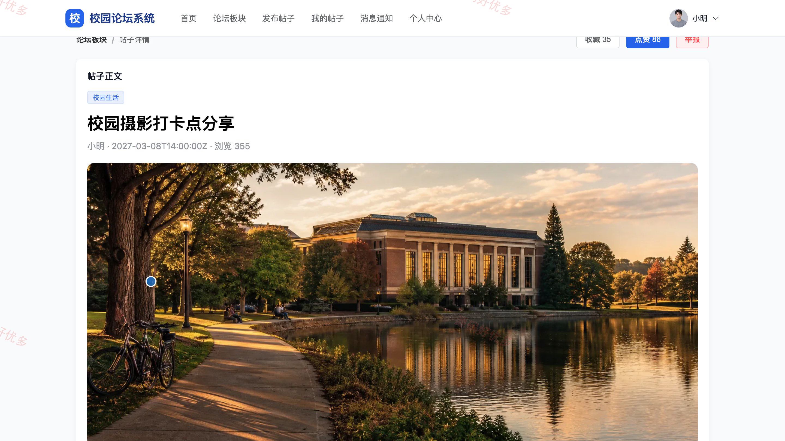
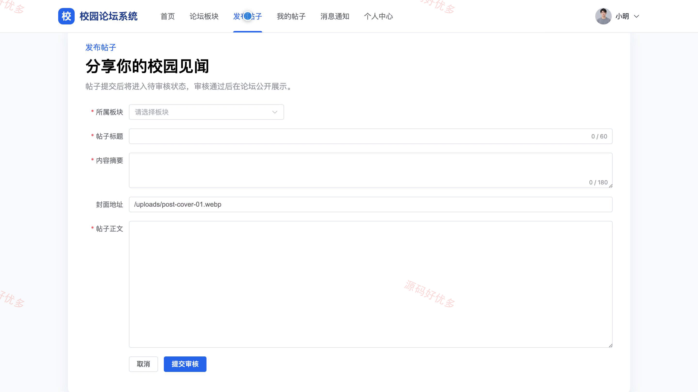
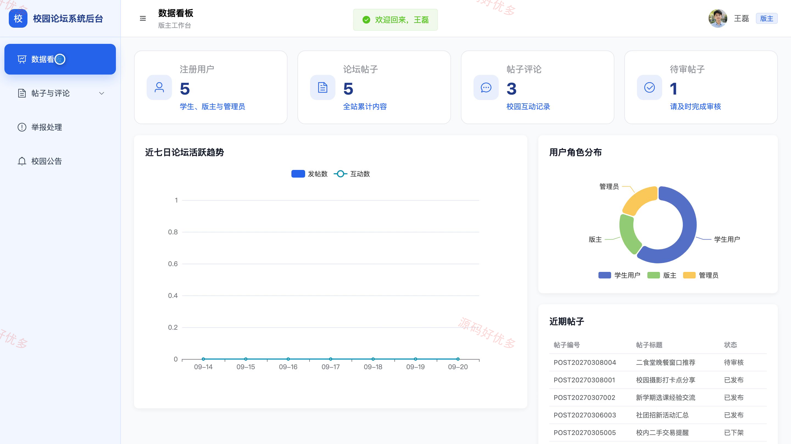
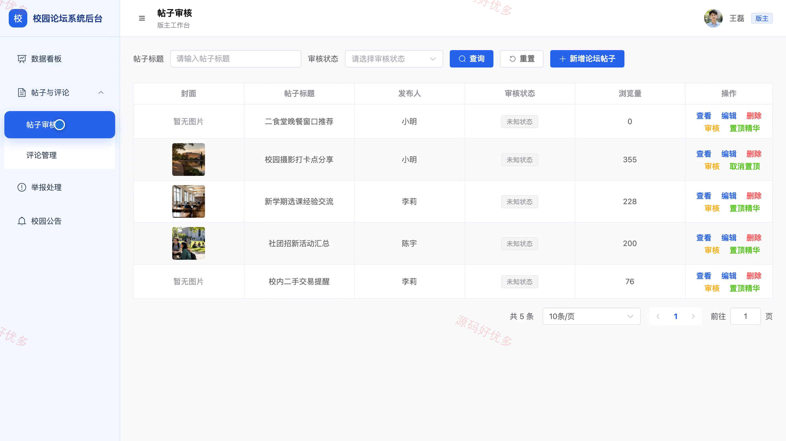
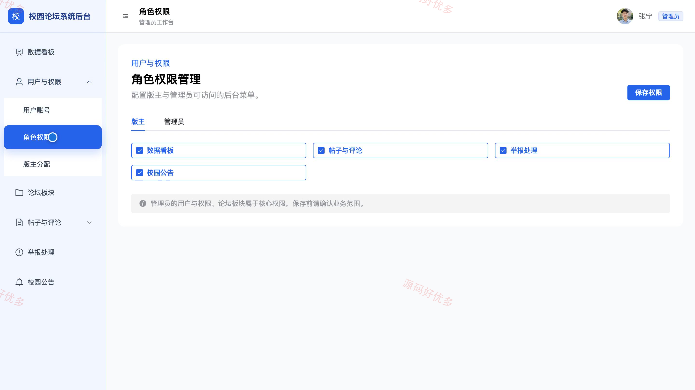
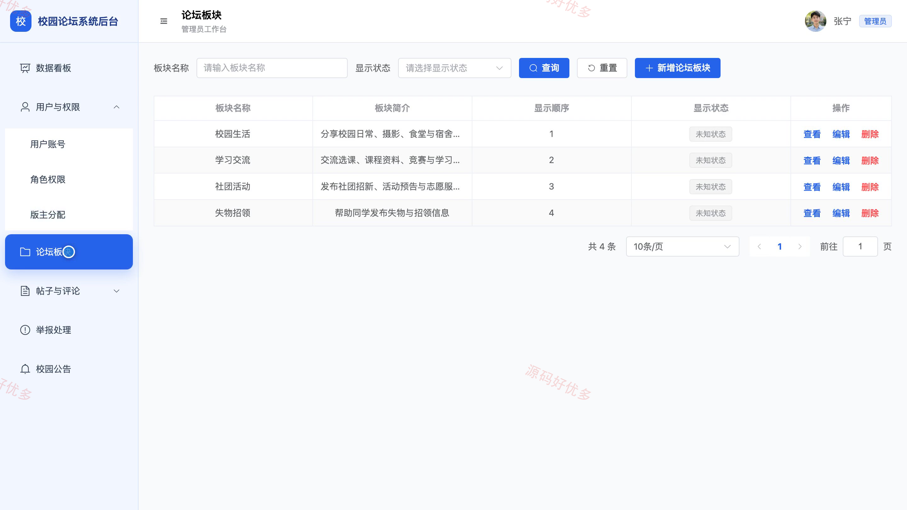

# bs092C
bs092C基于Django的校园论坛系统源码 Python Django Vue3 设计文档 PPT
## 源码问题查看主页咨询

### 一、关键词
校园社区、师生交流、帖子互动、内容审核、举报处理

### 二、作品包含
源码+数据库+万字设计文档+PPT+全套环境和工具资源+本地部署教程

### 三、项目技术
前端技术： Html、Css、Js、Vue3.4、Element-Plus
后端技术：Python、Django

### 四、运行环境要求
开发工具：PyCharm + VSCODE

数据库：MySQL5.7+（共15张表）

数据库管理工具：Navicat10以上版本

环境配置软件： Python3+

前端Nodejs：16+

浏览器：谷歌浏览器

### 五、项目介绍
项目编号：bs092C

本系统面向校园师生提供线上交流空间，覆盖公告浏览、帖子发布与互动、收藏消息、内容审核、举报处理及版块管理等场景，并为版主和管理员提供分级管理入口。

角色：学生用户、版主、管理员

学生用户功能：浏览校园公告与热门内容、按版块及关键词和热度筛选帖子、发布帖子并上传图片、对帖子点赞收藏并发表评论或回复、查看本人帖子与处理状态、查看消息通知、维护个人资料与修改密码。

版主功能：查看所负责版块的运营数据、审核待发布帖子、处理违规帖子与评论、核查用户举报并登记结果、设置帖子置顶与精华状态、发布和维护版块公告、维护个人资料。

管理员功能：管理用户账号与状态、配置管理员与版主权限、维护论坛版块、分配版主及其负责版块、处理全站帖子与评论、管理校园公告、查看举报记录与处理结果、查看用户帖子与互动统计。

### 六、运行截图

